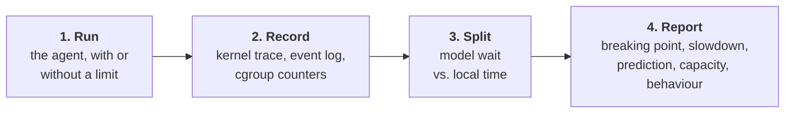

<h1 align="center">Diluted, Not Removed</h1>
<h3 align="center">How system limits slow down AI coding agents</h3>

<p align="center">
  <a href="https://doi.org/10.5281/zenodo.24490509"></a>
  <a href="#paper"></a>
  
  
  
</p>

An AI coding agent spends most of its time waiting for a language model.
So what happens when you put it in a small container?

We ran **Claude Code 2,199 times** under ten kinds of Linux limits, recorded a
**kernel trace of almost every run**, and measured three things: where each
limit starts to cost, how much of that cost the user sees, and what the agent
does about it.

```
                 ░ waiting for the model      ▓ work on the machine

no limit    ▓░░░░░░▓░░░░▓▓▓░░░░░▓                              21 s
0.25 core   ▓▓▓▓▓░░▓░░░░▓░░░▓▓▓▓▓▓▓▓▓▓▓▓▓▓▓▓▓▓░░░░░░▓          39 s

      the machine part takes 3.9x longer, but the user waits only 1.8x longer
```

The model wait **dilutes** the cost of a slow machine. It does not **remove** it.

---

## What we found

| Question | Short answer |
|---|---|
| **Where does the time go?** | With no limit, the agent waits for the model for 65 to 78% of a run on small tasks, and 42 to 66% on short real tasks. |
| **What does each limit do?** | Each limit has a breaking point and behaves in one of three ways: slower step by step (CPU quota, disk, threads), suddenly much slower (memory), or a crash (process limit). |
| **How much reaches the user?** | If the machine's share of a run is `f` and a limit makes that part `s` times longer, the user waits `1 + f (s - 1)` times longer. We measured `f` between 0.17 and 0.73. |
| **Can the cost be predicted?** | Kernel traces show that a CPU quota adds waiting, not work. A replay of runs with no limit predicts the run time within a median 6.9% on 89 held-out settings. |
| **Do real container sizes hurt?** | With 1 CPU or more, no slowdown we could detect on short real tasks. With 0.25 CPU, every task is still solved but takes 1.35 to 2.4 times longer. |
| **How many agents fit on a machine?** | Throughput stops growing at about 4 agents per vCPU. An estimate from one agent alone is 2.3 to 2.5 times too high. |
| **Does the agent react?** | Yes. A small model does extra work when a test prints a slow run time. And the kernel can kill the agent itself, with no message to the user. |

A small check with two other agents, **OpenHands** and **Codex**, shows the
same mechanism. Which prediction fits best depends on the agent.

## How the study works



- **The agent runs in its own cgroup.** We set one limit by writing one control
  file: `cpu.max`, `memory.high`, `memory.max`, `io.max` or `pids.max`.
- **Every run keeps three records:** an LTTng kernel trace, the agent's own
  event log, and the cgroup counters, read 5 times per second.
- **Local time** is the run time minus the time spent waiting for the model.
  It is the part of a run that the machine controls.

## What is in this repository

| Folder | Content |
|---|---|
| [`collector/`](collector/) | The tool that runs one agent, or many, under limits and records the run. The campaign files of every experiment are in `collector/campaigns/`. |
| [`phase2/`](phase2/) | The analysis scripts of the study, with their outputs (`*.txt`, `*.csv`, `RESULTS.md`) as used in the paper. |
| [`paper-icpe/`](paper-icpe/) | The paper source, its figures, and the script that draws them. |
| [`phase1/`](phase1/), [`latency/`](latency/), [`research-paper/`](research-paper/), [`provenance/`](provenance/) | An earlier pilot study on our first VM (see below). |

## Quick start

**Look at the results.** No setup is needed. Each analysis folder has its
output next to the script, for example `phase2/rev/a1.txt` for the replay
prediction and `phase2/rev/a14.txt` for the two other agents.

**Rerun an analysis.** You need Python 3.10 or newer, and only the standard
library. Download the run records from Zenodo (170 MB) and unpack them next
to `phase2/`.

```bash
tar -xzf os-noise-agents-data.tar.gz
cd phase2
python rev/a14_openhands.py ../data/other-agents/r_oh_cpu   # the OpenHands check
```

The other scripts, such as `rev/a1_eval.py` (replay prediction) and
`rev/a11_density.py` (agents per machine), read the data root from a path at
the top of the script or of `rev/common.py`. The `README.md` in the Zenodo
record says how its folders map to the names the scripts expect.

**Collect your own runs.** On an Ubuntu 24.04 VM with cgroup v2, LTTng and
an agent installed:

```bash
python3 collector/collect.py spec.json --out RUNS_DIR            # one run
python3 collector/campaign.py collector/campaigns/r_cpu.json     # a whole experiment
```

See [`collector/README.md`](collector/README.md) for the run spec and the VM setup.

## Dataset

The dataset is on Zenodo: **<https://zenodo.org/records/24490509>**
(DOI [`10.5281/zenodo.24490509`](https://doi.org/10.5281/zenodo.24490509))

| File | Size | Content |
|---|---|---|
| `os-noise-agents-code.tar.gz` | 1 MB | Collector, analysis scripts and their outputs |
| `os-noise-agents-data.tar.gz` | 170 MB | Records of 2,107 runs: setting, result, event log, counter samples |
| 60 `*.tar.zst` archives | 24.5 GB | Raw LTTng kernel traces, one archive per experiment (about 280 GB unpacked) |

Open a trace in Trace Compass, or turn it into text:

```bash
zstd -dc --long=31 r_cpu.tar.zst | tar -xf -
babeltrace2 --clock-gmt r_cpu/<run>/trace | gzip > trace.txt.gz
```

## Paper

> **Diluted, Not Removed: How System Limits Slow Down AI Coding Agents**
>
> Preprint: `arXiv:XXXX.XXXXX` *(placeholder, the link will be added here)*
>
> Dataset: <https://doi.org/10.5281/zenodo.24490509>

```bibtex
@misc{diluted-not-removed,
  title  = {Diluted, Not Removed: How System Limits Slow Down AI Coding Agents},
  author = {TODO},
  year   = {2026},
  note   = {arXiv:XXXX.XXXXX (placeholder)},
  doi    = {10.5281/zenodo.24490509}
}
```

## Earlier pilot study

The folders `phase1/`, `latency/`, `research-paper/` and `provenance/` hold a
smaller pilot study: 132 runs on one VM, with seven experiments. Its steps
are in [`REPRODUCE.md`](REPRODUCE.md) and its data layout in
[`DATA.md`](DATA.md). Its traces are a separate Zenodo record, DOI
[`10.5281/zenodo.23523441`](https://doi.org/10.5281/zenodo.23523441).

## License

Code is under the MIT license (see [`LICENSE`](LICENSE)). The datasets on
Zenodo are under CC BY 4.0.
